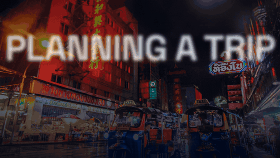

  

  

  
  
  
  

---

### 👋 About me

I'm an AI video editor from Kolkata with **3 years** of experience making short-form, UGC and performance-driven ad content.

- 🎬 **Right now:** Video Editor (AI + UGC) at **Cinqa**, taking AI-UGC commercials from brief to final export with HeyGen avatars and ElevenLabs voiceovers.
- ⚡ **What I care about:** a sharp hook in the first two seconds, tight pacing, and captions people actually read, so the message lands even with the sound off.
- 🛍️ **Brands:** I've made Meta ad creatives for e-commerce brands like **Nanobag** and **XYXX**.
- 🧪 **Lately:** building motion-graphics ads entirely in code with AI. See the project below.
- 🤝 **Open to** full-time, freelance or contract work, and I can start immediately.

---

### 🚀 Featured project: [FlightDeals Ad Studio](https://github.com/subhamde25/flightdeals-ad-studio)

Two video ads for **FlightDeals.in** (Visa checker · travel eSIMs · Hotels), made **entirely in code**. Every frame is rendered from HTML/JS, the music and sound effects are generated from scratch, and the AI voiceover is mixed in automatically. Both ads are delivered at 60 fps and mastered for social.

<table>
  <tr>
    <td align="center" width="62%">
       
      <b>16:9 YouTube</b> · "Ten tabs → one tab"
    </td>
    <td align="center" width="38%">
       
      <b>9:16 Reels</b> · "3 things you forget before flying abroad"
    </td>
  </tr>
</table>

<a href="https://github.com/subhamde25/flightdeals-ad-studio"><b>See the code, the brief and the full-quality ads →</b></a>

---

### 🧰 Toolkit

**Editing & motion design** 

**AI video & voice** 
    

**Where my videos live** 
   

**Code (for the ad studio)** 

---

### 💼 Experience

| Role | Where | When |
|---|---|---|
| **Video Editor (AI + UGC)** | Cinqa · Remote | Feb 2026 – Present |
| **AI Video Editing Intern** | Clipwise · Remote | Nov 2025 – Jan 2026 |
| **Freelance Video Editor** | Remote / Kolkata | Dec 2023 – Oct 2025 |

At Clipwise I made 50+ AI-generated and UGC-style videos for AI tools. As a freelancer I edited 40+ Reels and short-form videos for creators and brands, including Meta ad creatives for Nanobag and XYXX.

### 🎓 Education & languages

**B.Tech, Electronics & Communication Engineering** · Techno International Newtown, Kolkata (2018 – 2022) 
Bengali (native) · English (fluent) · Hindi (conversational)

---

  <b>Got a brand that needs scroll-stopping video?</b> 
  <a href="https://drive.google.com/drive/folders/1XC9nIIBPwq5x7vN_wSzvOljvwsSFOHLE">Portfolio</a> ·
  <a href="mailto:deysubhamrey619@gmail.com">deysubhamrey619@gmail.com</a>

  

